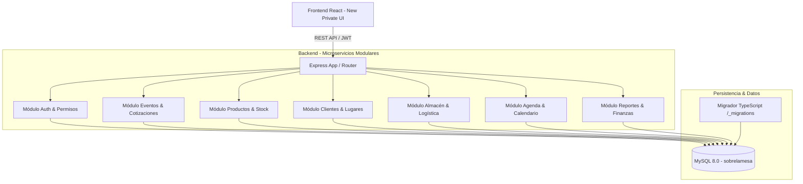
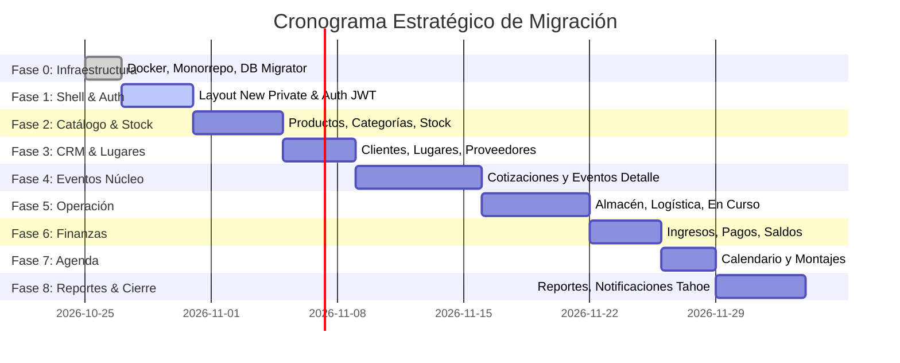

# Plan Estratégico de Migración: De Laravel 5.1 (Legacy) a Microservicios Modulares

## 1. Resumen Ejecutivo y Objetivos

Este documento establece el plan arquitectónico y operativo para la modernización y migración integral del sistema empresarial **Sobre La Mesa (SLM)**. 

### Origen
- **Proyecto Legacy:** `/Users/carlosrodriguez/development/projects/php7/slm`
- **Stack Legacy:** Laravel 5.1 (PHP 7.x), arquitectura monolítica, vistas Blade con jQuery, DataTables tradicionales y estilos dispersos.

### Destino
- **Proyecto Moderno:** Monorrepo `sobrelamesa2026/`
- **Stack Destino:** 
  - **Backend:** Node.js / Express con TypeScript, arquitectura por capas (Clean Architecture / Domain-Driven Design) desacoplada en microservicios modulares y sistema de migraciones nativo.
  - **Frontend (`slm`):** React SPA moderna, replicando con fidelidad el diseño del layout premium definido en `resources/views/admin/template/new_private.blade.php` y `modern_admin.css`.
  - **Base de Datos:** MySQL 8.0 en contenedor Docker orquestado.

---

## 2. Análisis del Sistema Legacy (`php7/slm`)

### 2.1 Estructura del Monolito
El proyecto legacy se compone de dos carpetas principales:
1. `sobrelamesa/`: Código fuente de Laravel 5.1 (`app/`, `resources/views/`, `config/`, `database/`).
2. `slm/`: Webroot público (`index.php`, `css/`, `js/`, `plugins/`, `images/`).

### 2.2 Inventario de Controladores y Dominios
En `app/Http/Controllers/` se identificaron 14 controladores principales que agrupan todas las operaciones del negocio:

| Controlador Legacy | Dominio / Responsabilidad | Complejidad |
|---|---|:---:|
| `Auth/AuthController.php` & `LoginController.php` | Inicio de sesión, autenticación, recuperación de contraseñas. | Media |
| `Admin/UsuarioController.php` | Gestión de usuarios, roles, asignación de permisos individuales. | Media |
| `Admin/InicioController.php` | Tablero de control (dashboard), métricas rápidas de eventos y ventas. | Baja |
| `Admin/EventoController.php` | Núcleo del sistema: cotizaciones, eventos, estados, detalle de productos, almacén, ingresos. | **Muy Alta** |
| `Admin/EventosClienteController.php` | Histórico y seguimiento de eventos agrupados por cliente. | Media |
| `Admin/ProductoController.php` | Catálogo de productos, stock, precios, imágenes, categorías. | Alta |
| `Admin/InventarioDiaController.php` | Disponibilidad y bloqueo de stock de productos por fechas. | Alta |
| `Admin/ClienteController.php` | Directorio de clientes (persona física y moral), teléfonos, direcciones. | Media |
| `Admin/LugarController.php` | Gestión de recintos, salones y venues para eventos. | Baja |
| `Admin/LogisticaController.php` | Programación de entregas, recolecciones, chóferes y vehículos. | Alta |
| `Admin/CalendarioController.php` | Agenda interactiva (FullCalendar) con montajes, eventos y desmontajes. | Media |
| `Admin/ReportesController.php` | Generación de reportes de ventas, inventario, comisiones y rentabilidad. | Alta |
| `Admin/ConfiguracionController.php` | Parámetros globales de la empresa, políticas comerciales y metas. | Baja |
| `Admin/NotificationController.php` | Notificaciones del sistema para usuarios. | Media |

### 2.3 Deuda Técnica Identificada en el Legacy
1. **Controladores con sobrecarga de lógica (Fat Controllers):** Métodos que superan las 300 líneas de código ejecutando validación, queries raw y renderizado simultáneamente.
2. **Seguridad y Criptografía Obsoleta:** Contraseñas almacenadas en texto plano (`pwd`) y algoritmos antiguos (resuelto en fase 0 con migración a `bcrypt`).
3. **Ausencia de APIs REST estandarizadas:** Endpoints acoplados a respuestas mixtas (a veces JSON, a veces redirecciones HTML).
4. **Acoplamiento de vistas con jQuery/DOM Directo:** Manipulación directa del DOM y plugins dependientes de jQuery (`daterangepicker`, `select2`, `datatables.net`).

---

## 3. Arquitectura Objetivo: Microservicios Modulares

Para garantizar escalabilidad sin incurrir en la sobrecarga prematura de múltiples repositorios, la arquitectura se estructura como **Monolito Modular con límites estrictos de microservicio (Service-Oriented Monorepo)**:



### 3.1 Estructura Estándar de Cada Módulo Backend
Cada parte del sistema se implementa de manera idéntica y autónoma dentro de `backend/src/modules/<modulo>/`:

```
backend/src/modules/<modulo>/
├── controllers/          # Controladores HTTP: parseo de req, códigos de estado, res
├── services/             # Lógica de negocio pura, reglas de validación y cálculos
├── repository/           # Capa de acceso a datos (queries SQL optimizadas con mysql2)
│   ├── <modulo>.repository.ts       # Interfaz abstracta del repositorio
│   └── <modulo>.repository.mysql.ts # Implementación en MySQL
├── interfaces/           # DTOs, entidades y tipados TypeScript
└── routes/               # Definición de rutas Express (/api/<modulo>)
```

---

## 4. Especificación del Sistema de Diseño (`new_private`)

El nuevo frontend debe replicar la interfaz de usuario implementada en:
- Plantilla: `/Users/carlosrodriguez/development/projects/php7/slm/sobrelamesa/resources/views/admin/template/new_private.blade.php`
- Estilos: `/Users/carlosrodriguez/development/projects/php7/slm/slm/css/modern_admin.css`
- Parciales: `sidebar.blade.php` y `navbar.blade.php`

### 4.1 Layout Shell
- **Sidebar (`#sidebar-wrapper`):**
  - Ancho estándar: `260px`.
  - Modo Mini (Iconos colapsados): `60px` con animación de transición fluida (`transition: all 0.3s ease`).
  - Fondo: Gradiente oscuro `linear-gradient(180deg, #1a2035, #11162a)`.
  - Sombra: `box-shadow: 4px 0 12px rgba(0, 0, 0, 0.25)`.
  - Enlaces (`.nav-link-custom`): Color `#aeb9cc`, hover `#fff` con elevación `transform: translateX(4px)`.
  - Estado activo (`.active`): `linear-gradient(135deg, #0d6efd, #3d8bfd)` con sombra `0 6px 12px rgba(13, 110, 253, 0.35)`.
  - Persistencia: Estado mini guardado en `localStorage` / cookie para recordar preferencia del usuario.
  - Modo Mobile (`< 1200px`): Oculto por defecto con margen negativo `-260px`, se abre con backdrop superpuesto (`sidebar-show`).

- **Navbar (`.navbar-custom`):**
  - Altura fija: `60px`.
  - Sticky en la parte superior (`position: sticky; top: 0; z-index: 1050`).
  - Fondo: `#ffffff` con sombra sutil `0 2px 10px rgba(0, 0, 0, 0.06)`.
  - Botón hamburguesa para colapsar a mini en Desktop y desplegar en Mobile.
  - Avatar de usuario con iniciales y dropdown de perfil/cerrar sesión.

- **Contenedor Principal (`#page-content-wrapper`):**
  - Fondo: `#f5f4f4ff` (`bg-light-blue`).
  - Padding interior: `24px` (`p-24`).

### 4.2 Componentes UI Clave (`modern_admin.css`)
- **Tablas Flotantes (`.table-custom`):**
  - Separación de filas: `border-collapse: separate; border-spacing: 0 0.5rem`.
  - Filas elevadas con fondo blanco y sombra: `background-color: #fff; box-shadow: 0 1px 3px rgba(0,0,0,0.05)`.
  - Efecto hover: `box-shadow: 0 4px 12px rgba(0,0,0,0.08)`.
  - Borde izquierdo indicador en selección activa: `border-left: 3px solid #0d6efd`.
  - Celdas con esquinas redondeadas (`border-radius: 8px`).
- **Tarjetas de Filtro (`.filter-section`):**
  - Fondo blanco, radio de `12px`, padding de `1.5rem`, sombra suave.
- **Inputs Modernos:**
  - `border-radius: 20px`, fondo `#f8f9fa`, foco con anillo `rgba(13, 110, 253, 0.15)`.
- **Badges (`.badge-custom`):**
  - Forma de píldora (`border-radius: 20px`), tipografía de peso medio.
- **Notificaciones Estilo macOS Tahoe:**
  - Tarjetas flotantes en la esquina superior derecha (`.notification-container`), con desenfoque de fondo (`backdrop-filter: blur(12px)`), apilamiento en perspectiva 3D y auto-dismiss.
- **Visor de Imágenes Premium (`.premium-zoom-overlay`):**
  - Overlay fixed con blur `background: rgba(15, 23, 42, 0.75); backdrop-filter: blur(12px)`, animación elástica y botones circulares de control.

---

## 5. Fases de Ejecución del Plan de Migración



### Fase 0: Infraestructura y Base (✅ Completada)
- Configuración de monorrepo con PNPM y Docker Compose.
- Sistema de migraciones versionadas en backend (`backend/src/database/migrator.ts`).
- Script de migración de contraseñas legacy a bcrypt (`hash:passwords`).
- Desacoplamiento de la base de datos de Docker.

### Fase 1: Shell `new_private` y Autenticación Completa (En Curso)
- Replicar el layout exacto de `new_private.blade.php` en React (`slm/src/layouts/PrivateLayout.jsx`).
- Implementar el Sidebar interactivo con modo mini (60px), animaciones y colores originales.
- Implementar el Navbar sticky con menú de usuario y switch de modo oscuro/claro si aplica.
- Completar flujo de Auth: Refresh Tokens en base de datos (`hashed_refresh_token`), protección de rutas y permisos de usuario.

### Fase 2: Módulo de Catálogo e Inventario
- Migración de controladores `ProductoController` y modelos `Producto`, `CategoriaProducto`, `SubCategoriaProducto`.
- Tablas flotantes con fotos de producto, buscador con debounce y filtros por categoría.
- Visor de imágenes premium (zoom elástico con blur).
- Control de stock diario (`InventarioDiaController`).

### Fase 3: Directorio de Clientes y Recintos
- Migración de `ClienteController`, `LugarController` y `Proveedor`.
- Vistas React con cards de clientes, historial de compras y modalidades (Persona física/moral).
- Catálogo de recintos con capacidades, direcciones y contactos.

### Fase 4: Núcleo de Negocio - Eventos y Cotizaciones
- Migración de `EventoController` (el módulo más crítico).
- Creador/Editor interactivo de cotizaciones con cálculo de precios, IVA, descuentos y cargos por flete.
- Detalle de productos por evento (`DetalleEvento`, `DetalleEventoContent`).
- Estados de eventos (Cotización, Confirmado, En Almacén, Finalizado, Cancelado).

### Fase 5: Almacén y Logística
- Pantalla de eventos en curso para bodega (`evento.get_event_almacen_prueba`).
- Checklists de salida de material, devoluciones y reporte de roturas/pérdidas.
- Rutas de transporte y asignación de unidades (`LogisticaController`).

### Fase 6: Ingresos y Finanzas
- Módulo de anticipos, liquidaciones y saldos pendientes por evento (`IngresoEvento`, `HistorialIngresos`).
- Generación de recibos de pago y control de métodos de pago.

### Fase 7: Agenda y Calendario
- Integración de vista de calendario mensual/semanal para programar montajes, eventos y desmontajes.
- Detección de colisiones de fechas y stock.

### Fase 8: Reportes, Notificaciones y Configuración
- Reportes exportables (PDF / Excel) de ventas, comisiones y productos más rentados.
- Notificaciones en tiempo real estilo macOS Tahoe.
- Parámetros globales de empresa y metas de venta.

---

## 6. Procedimientos de Verificación y Criterios de Aceptación

Para dar por concluida la migración de cada módulo se debe validar:
1. **Fidelidad Visual:** El diseño debe alinearse con la estética de `new_private.blade.php` y `modern_admin.css`.
2. **Consistencia de Datos:** Las consultas en el backend moderno deben devolver los mismos resultados que el sistema PHP 7 legacy.
3. **Manejo de Errores y Validaciones:** Respuestas tipadas con códigos HTTP estándar (`200`, `201`, `400`, `401`, `403`, `404`, `500`).
4. **Idempotencia:** Toda alteración a la base de datos debe ser registrada mediante una migración formal en `backend/src/database/migrations/`.
